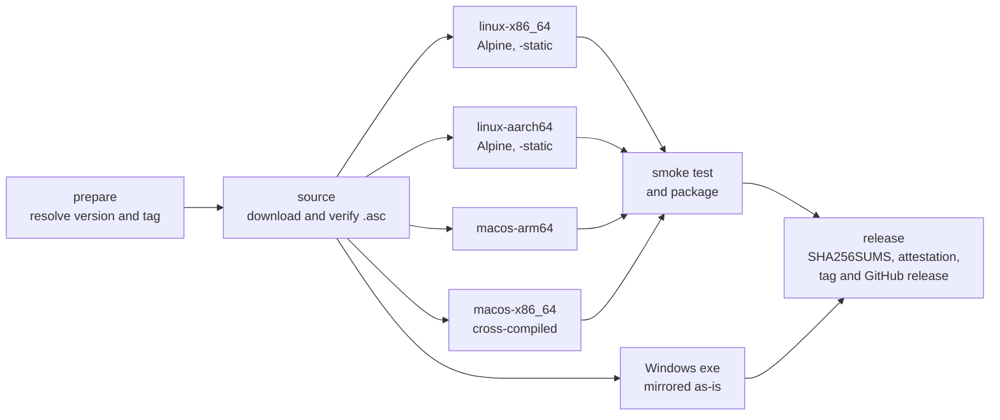
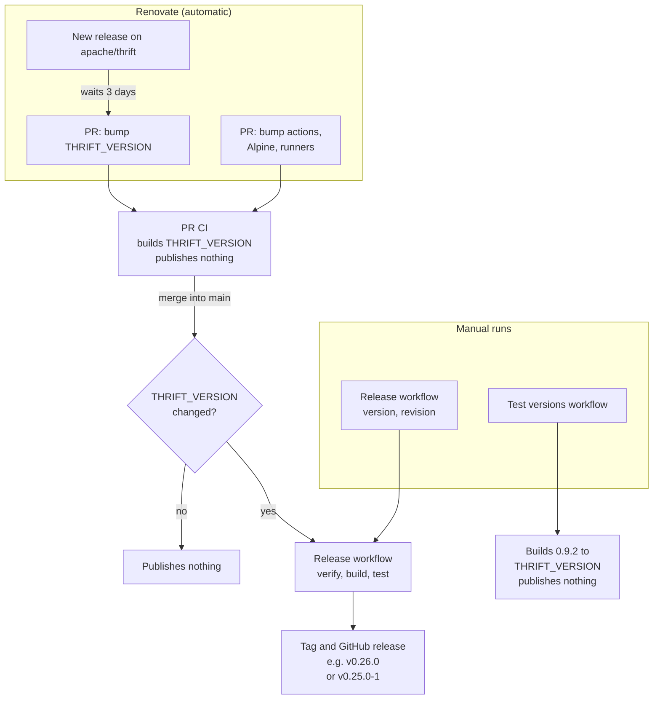

# thrift-compiler-binaries

Prebuilt binaries of the [Apache Thrift](https://thrift.apache.org/) compiler (`thrift`) for Linux and macOS, built from the upstream source releases by GitHub Actions.

> [!IMPORTANT]
> This is an **unofficial**, community-maintained build. It is **not affiliated with, endorsed by, or supported by the Apache Software Foundation** or the Apache Thrift project. Apache Thrift, Thrift, Apache, and the Apache feather logo are trademarks of the Apache Software Foundation.
> For official releases, see <https://thrift.apache.org/download>.

## Why

The Thrift project publishes a source tarball and a Windows `.exe`, but no prebuilt compiler for macOS or Linux. Package managers usually ship only one version (often an old one on Linux distributions). This repository builds any released version on demand, so you can pin the compiler version your project needs.

## Platforms

| Asset | Platform | Notes |
| --- | --- | --- |
| `thrift-<version>-linux-x86_64.tar.gz` | Linux x86_64 | Fully static (musl), runs on any distribution |
| `thrift-<version>-linux-aarch64.tar.gz` | Linux aarch64 | Fully static (musl), runs on any distribution |
| `thrift-<version>-macos-arm64.tar.gz` | macOS 11+ arm64 | Apple silicon |
| `thrift-<version>-macos-x86_64.tar.gz` | macOS 11+ x86_64 | Intel |
| `thrift-<version>-windows-x86.exe` | Windows | Upstream's official exe, mirrored as-is, with upstream's `.asc` signature |

Each tarball contains a single directory with the `thrift` binary and the upstream `LICENSE` and `NOTICE` files:

```
thrift-0.25.0-linux-x86_64/
├── LICENSE
├── NOTICE
└── thrift
```

Release tags match the upstream version (`v0.25.0`). If a version has to be rebuilt, the new release gets a suffix (`v0.25.0-1`, `v0.25.0-2`, …); the asset names stay the same.

## Install

```sh
VERSION=0.25.0
PLATFORM=linux-x86_64   # linux-x86_64 | linux-aarch64 | macos-arm64 | macos-x86_64
BASE=https://github.com/be-hase/thrift-compiler-binaries/releases/download/v$VERSION

curl -fsSLO "$BASE/thrift-$VERSION-$PLATFORM.tar.gz"
curl -fsSLO "$BASE/SHA256SUMS"
sha256sum --check --ignore-missing SHA256SUMS   # macOS: shasum -a 256 --check --ignore-missing SHA256SUMS

tar -xzf "thrift-$VERSION-$PLATFORM.tar.gz"
install -m 0755 "thrift-$VERSION-$PLATFORM/thrift" ~/.local/bin/thrift
thrift --version
```

Or with the GitHub CLI:

```sh
gh release download v0.25.0 --repo be-hase/thrift-compiler-binaries \
  --pattern 'thrift-0.25.0-linux-x86_64.tar.gz' --pattern SHA256SUMS
```

## Verifying downloads

### Checksums

Every release has a `SHA256SUMS` file covering all of its assets:

```sh
sha256sum --check --ignore-missing SHA256SUMS
```

### Build provenance

The tarballs carry a [GitHub artifact attestation](https://docs.github.com/actions/security-for-github-actions/using-artifact-attestations) showing which workflow run in this repository built them, and from which commit:

```sh
gh attestation verify thrift-0.25.0-linux-x86_64.tar.gz \
  --repo be-hase/thrift-compiler-binaries
```

The mirrored Windows exe was built by upstream, not here, so it has no attestation. Verify it with upstream's signature:

```sh
curl -fsSLO https://downloads.apache.org/thrift/KEYS
gpg --import KEYS
gpg --verify thrift-0.25.0-windows-x86.exe.asc thrift-0.25.0-windows-x86.exe
```

## How the binaries are built

See [`.github/workflows/build.yml`](.github/workflows/build.yml) and [`.github/workflows/release.yml`](.github/workflows/release.yml).



1. Download `thrift-<version>.tar.gz` and its `.asc` from `downloads.apache.org`, falling back to `archive.apache.org` for older versions. Verify the signature against the upstream [KEYS](https://downloads.apache.org/thrift/KEYS) file. The build stops if verification fails.
2. Build only the compiler (CMake target `thrift-compiler`, with `-DBUILD_LIBRARIES=OFF -DBUILD_TESTING=OFF`). The upstream source is not modified.
   - **Linux**: in an Alpine container, linked with `-static`. x86_64 builds on `ubuntu-24.04`, aarch64 on `ubuntu-24.04-arm`.
   - **macOS**: on an Apple silicon runner, one build per architecture (`-DCMAKE_OSX_ARCHITECTURES=arm64` or `x86_64`; x86_64 is cross-compiled), targeting macOS 11 and using Homebrew's bison and flex.
3. Smoke-test each binary:
   - check the `thrift --version` output
   - generate Java, Python, Go, C++ and JavaScript code from [`test/smoke.thrift`](test/smoke.thrift)
   - Linux: confirm with `file` and `ldd` that the binary is static, then run it on the Ubuntu host rather than in Alpine
   - macOS: confirm with `lipo` that the binary contains only the expected architecture, that it still targets macOS 11, and that it links only system libraries. The x86_64 binary is tested under Rosetta.
4. Package each binary with upstream's `LICENSE` and `NOTICE`, generate `SHA256SUMS`, attest build provenance, and publish the GitHub release.

## Lifecycle



- **New upstream release**: [Renovate](https://docs.renovatebot.com/) watches `apache/thrift` releases. Three days after a new one appears, giving the tarball time to reach the mirrors, it opens a PR that bumps [`THRIFT_VERSION`](THRIFT_VERSION). The PR's CI builds and tests that version. Merging the PR builds it again and publishes `v<version>`.
- **Dependency updates**: Renovate also bumps the pinned actions, the Alpine image digest and the runner labels. Their PRs build and test `THRIFT_VERSION`; merging them publishes nothing.
- **Backfilling or rebuilding a version**: run the *Release* workflow manually with `version`. Add `revision` to rebuild an existing release (`revision: 1` → `v0.25.0-1`); the original release stays.
- **Tags** are created by the workflow only after a successful build. Pushing a tag by hand does not trigger a release.
- **"Latest"** goes to a release only if it is the newest version, so backfilled old versions never take it over.
- **Testing without releasing**: the *Test versions* workflow builds and smoke-tests every upstream version from 0.9.2 (the first with a CMake build for the compiler) up to `THRIFT_VERSION`, or the versions you pass in. It only runs manually, e.g. before backfilling, or after changing the build in a way that may affect old sources.

The build itself lives in the reusable [`.github/workflows/build.yml`](.github/workflows/build.yml), which both workflows call.

## License

The scripts and workflows in this repository are licensed under the [Apache License 2.0](LICENSE).

The distributed binaries are built from Apache Thrift, which is licensed under the Apache License 2.0. Each archive includes upstream's `LICENSE` and `NOTICE` files.
