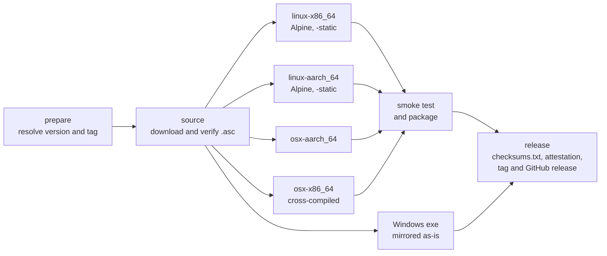
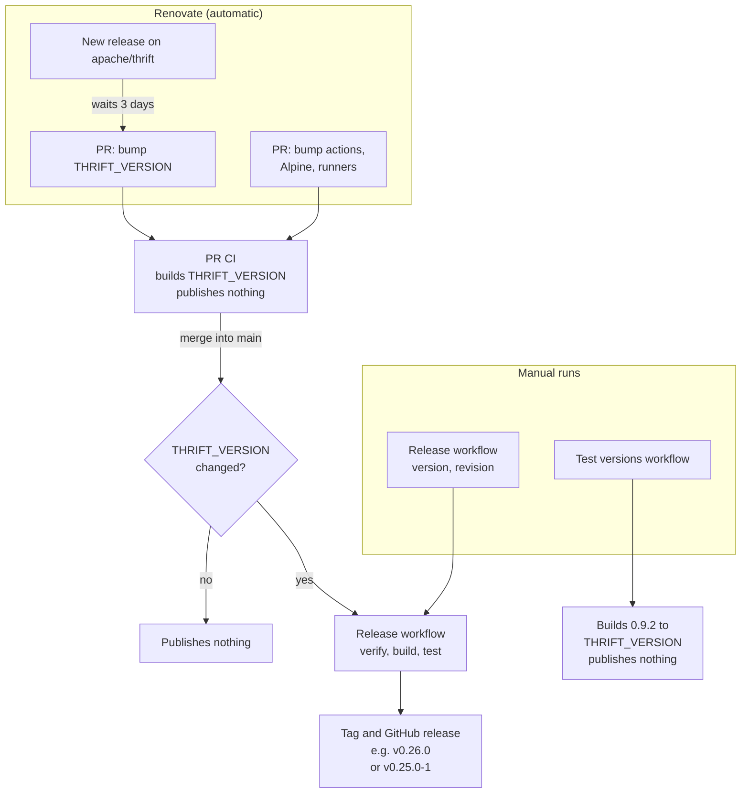

# Maintenance

How this repository builds and publishes releases. For using the binaries, see the [README](../README.md).

## Repository layout

| Path | Purpose |
| --- | --- |
| [`THRIFT_VERSION`](../THRIFT_VERSION) | Newest upstream version to release. Bumped by Renovate. |
| [`.github/workflows/build.yml`](../.github/workflows/build.yml) | Reusable workflow: fetch, verify, build, smoke-test and package one version. Publishes nothing. |
| [`.github/workflows/release.yml`](../.github/workflows/release.yml) | Calls `build.yml` and publishes the GitHub release. |
| [`.github/workflows/test-versions.yml`](../.github/workflows/test-versions.yml) | Calls `build.yml` for many versions. Publishes nothing. |
| [`scripts/`](../scripts) | The steps the workflows run; they also work locally. |
| [`test/smoke.thrift`](../test/smoke.thrift) | IDL used by the smoke test. |
| [`renovate.json`](../renovate.json) | Tracks upstream releases, pinned actions, the Alpine image and runner labels. |

## How a release is built

1. Download `thrift-<version>.tar.gz` and its `.asc` from `downloads.apache.org`, falling back to `archive.apache.org` for older versions. Verify the signature against the upstream [KEYS](https://downloads.apache.org/thrift/KEYS) file. The build stops if verification fails.
2. Build only the compiler (CMake target `thrift-compiler`, with `-DBUILD_LIBRARIES=OFF -DBUILD_TESTING=OFF`). The upstream source is not modified.
   - **Linux**: in an Alpine container, linked with `-static`. x86_64 builds on `ubuntu-24.04`, aarch64 on `ubuntu-24.04-arm`.
   - **macOS**: on an Apple silicon runner, one build per architecture (`-DCMAKE_OSX_ARCHITECTURES=arm64` or `x86_64`; x86_64 is cross-compiled), targeting macOS 11 and using Homebrew's bison and flex.
3. Smoke-test each binary:
   - check the `thrift --version` output
   - generate Java, Python, Go, C++ and JavaScript code from [`test/smoke.thrift`](../test/smoke.thrift)
   - Linux: confirm with `file` and `ldd` that the binary is static, then run it on the Ubuntu host rather than in Alpine
   - macOS: confirm with `lipo` that the binary contains only the expected architecture, that it still targets macOS 11, and that it links only system libraries. The x86_64 binary is tested under Rosetta.
4. Package each binary with upstream's `LICENSE` and `NOTICE`, generate `checksums.txt`, attest build provenance, and publish the GitHub release.

## Lifecycle

- **New upstream release**: [Renovate](https://docs.renovatebot.com/) watches `apache/thrift` releases. Three days after a new one appears, giving the tarball time to reach the mirrors, it opens a PR that bumps `THRIFT_VERSION`. The PR's CI builds and tests that version. Merging the PR builds it again and publishes `v<version>`.
- **Dependency updates**: Renovate also bumps the pinned actions, the Alpine image digest and the runner labels. Their PRs build and test `THRIFT_VERSION`; merging them publishes nothing.
- **Backfilling or rebuilding a version**: run the *Release* workflow manually with `version`. Add `revision` to rebuild an existing release (`revision: 1` → `v0.25.0-1`); the original release stays.
- **Tags** are created by the workflow only after a successful build. Pushing a tag by hand does not trigger a release.
- **"Latest"** goes to a release only if it is the newest version, so backfilled old versions never take it over.
- **Testing without releasing**: the *Test versions* workflow builds and smoke-tests every upstream version from 0.9.2 (the first with a CMake build for the compiler) up to `THRIFT_VERSION`, or the versions you pass in. It only runs manually, e.g. before backfilling, or after changing the build in a way that may affect old sources. 0.9.3.1 is skipped: its compiler is unchanged and still reports itself as 0.9.3.
